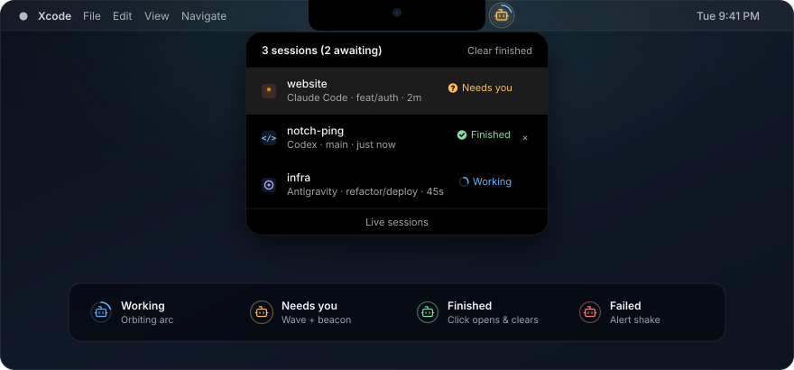

<div align="center">

# Notch Ping

**A tiny, dependency-free native macOS notch indicator for coding agents that finish or need you.**

[](#requirements)
[](#architecture--development)
[](#privacy--security)
[](#privacy--security)
[](LICENSE)

<br />



</div>

---

## Why Notch Ping?

When you have two or three sessions of **Codex**, **Claude Code**, or **Antigravity (`agy`)** running in parallel and switch over to a browser, IDE, or notes app, you either waste focus babysitting terminal spinners or realize 15 minutes later an agent has been parked on a permission prompt.

**Notch Ping** gives you a peripheral-vision "tap on the shoulder" right beside your MacBook's camera notch — without widening the notch, covering menu-bar items, stealing keyboard focus, or reading your conversations:

- **Invisible at idle:** When nothing is running or waiting on you, nothing is drawn next to the notch (`0.0%` CPU, zero background timers).
- **Readable in 0.1 seconds:** Each state has its own color *and* GPU-driven motion signature so you immediately know whether agents are actively working, blocked on a question, finished, or failed.
- **Instant peek, zero focus theft:** Hover near the notch (`35 ms`) to drop a fixed-width card straight down below the menu bar showing each session's **repo**, **git branch / worktree**, and **elapsed time** (`Claude Code · feat/auth · 2m`).
- **Click to jump & auto-clear:** Clicking a session brings its originating app forward (`cmux`, `Terminal`, `iTerm`, `Warp`, `Codex Desktop`, `Claude Desktop`, or `Antigravity`), collapses the card, and **automatically clears `Finished` notifications** so you never have to clean up completed turns by hand.

---

## Visual States at a Glance

| State | Notch Indicator | Dropdown Badge | Click Behavior |
| :--- | :--- | :--- | :--- |
| **Working** | **Blue** Bot + smooth orbiting progress arc *(remains visible around green/amber states when another session is still running)* | Spinning blue arc · `Working` | Opens originating app; keeps session tracked |
| **Needs you** | **Amber** Bot + arrival wave + outward-radiating beacon *(settles to an amber pip once glanced at)* | `?` badge · `Needs you` | Opens originating app so you can answer/approve |
| **Finished** | **Green** Bot + celebratory bloom + calm breathing glow until glanced at | `✓` badge · `Finished` | Opens originating app **and auto-clears** the row |
| **Command failed** | **Red** Bot + crisp horizontal error shake + alert flash | `⚠` badge · `Command failed` | Opens originating app; dismissible via `×` |

> **Accessibility:** Under macOS **Reduce Motion**, all continuous animations automatically switch to distinct static equivalents (segmented progress ring, static halo, amber badge pip).

---

## Quick Start

### Requirements
- **macOS 14.0+** (Sonoma or newer)
- **Xcode / Swift 6.0+** toolchain
- **Python 3.11+** (used only by the setup scripts; the running app and hook relay are 100% native Swift executables with zero third-party dependencies)

### Build, Connect Hooks & Launch

```sh
./scripts/build.sh
python3 scripts/hooks.py install
python3 scripts/codex_hook_setup.py --trust
open "dist/Notch Ping.app"
```

1. **`./scripts/build.sh`** compiles release binaries for `NotchPing` and `notch-relay` and packages an ad-hoc signed `dist/Notch Ping.app`.
2. **`python3 scripts/hooks.py install`** copies `notch-relay` to `~/Library/Application Support/NotchPing/bin/notch-relay` and registers observer-only lifecycle hooks in `~/.codex/hooks.json`, `~/.claude/settings.json`, and `~/.gemini/config/hooks.json` after saving timestamped backups. Unrelated settings and hooks are preserved.
3. **`python3 scripts/codex_hook_setup.py --trust`** reviews and trusts *only* Notch Ping's exact hook hashes via your running Codex daemon and hot-reloads user config (preserving any existing `notify` command and settings). You can also trust hooks manually via Codex's `/hooks` UI.
4. **`open "dist/Notch Ping.app"`** starts Notch Ping in live mode (accessible anytime from the menu-bar bell icon).

---

## Try the Interactive Demo

Want to preview every state animation, branch/age row, and Reduced Motion behavior without touching your live socket or real sessions? Quit any running copy first, then launch with `--demo`:

```sh
open "dist/Notch Ping.app" --args --demo
```

Demo mode is strictly isolated: it never binds the live `events.sock` listener and never writes to disk. Quit and launch normally to return to live sessions.

---

## How Origin App Routing Works

- **Automatic process-ancestry detection:** When a hook fires, `notch-relay` walks its parent process tree (including across macOS `/usr/bin/login` shells in `Terminal.app` and `iTerm2`) to identify `cmux`, `Terminal`, `iTerm`, `Warp`, `Codex Desktop`, `Claude Desktop`, or `Antigravity`.
- **No false guesses across shared daemons:** When plain `codex` CLI runs behind its shared background daemon, `notch-relay` stops at the daemon boundary rather than guessing from unrelated open windows.
- **One-click app memory:** If a session's origin isn't automatically discoverable, clicking the row (or right-clicking → **Open in…**) pops up an app picker once and remembers that choice for the session across restarts.
- **Orphaned session recovery:** Active local CLI turns (`agy`, `claude`) automatically reconcile if their host process terminates unexpectedly without emitting an end hook. Protected `Working` / `Needs you` rows also offer right-click **Dismiss Session (Force)** and menu-bar **Clear All Sessions**.

---

## Privacy & Security

Notch Ping is built around strict local boundaries:

- **Zero network, zero telemetry:** No network entitlements, HTTP calls, analytics, updaters, login items, or background daemons.
- **Observer-only hooks:** Hook handlers never approve permissions, block tools, rewrite arguments, or inject prompts/context. They emit `{}` (and Antigravity's neutral policy-delegating `{"decision":"allow"}` on `PreToolUse`). Closing Notch Ping never blocks or slows down your coding agents.
- **Zero transcript or prompt access:** `notch-relay` strips hook payloads down to provider, session ID, project folder name, git branch name (read safely via `O_NOFOLLOW | O_NONBLOCK` from `.git/HEAD` only), lifecycle action, detected origin app, and timestamp. Prompts, assistant messages, tool arguments, and `transcript_path` files are never opened, forwarded, or stored.
- **Locked-down local IPC & storage:** Events travel as bounded Unix datagrams over `~/Library/Application Support/NotchPing/events.sock` (`0600` atomically at `bind`) inside a user-owned `0700` directory. Pending attention queues live strictly in memory; per-session origin records store only `{app, timestamp}` under SHA-256 hashed filenames (`0600`, 30-day expiry, 512-record cap).
- **Backed-up, surgical configuration edits:** Every change to `~/.codex/hooks.json`, `~/.claude/settings.json`, `~/.gemini/config/hooks.json`, or `~/.codex/config.toml` saves a `0600` backup under `~/Library/Application Support/NotchPing/backups/<timestamp>/` first.

---

## Uninstall

```sh
python3 scripts/hooks.py uninstall
```

Removes **only** handlers whose command matches Notch Ping's relay and deletes the copied `notch-relay` binary, leaving all unrelated hooks, user settings, and backups intact. Quit **Notch Ping** from the menu-bar bell icon and remove the repository folder whenever you're done.

---

## Architecture & Development

```text
NotchPing/
├── Sources/
│   ├── NotchCore/     # Attention state machine, hook normalization, git/origin detection, Unix socket IPC
│   ├── NotchRelay/    # Fast, short-lived native CLI hook helper (`notch-relay`)
│   └── NotchPing/     # AppKit non-activating notch panel, SwiftUI animations, live datagram server, demo UI
├── Tests/
│   └── NotchCoreTests/# Swift Testing suite covering lifecycle races, origin routing, git safety & subprocesses
├── scripts/
│   ├── build.sh       # Release build, Info.plist generation & ad-hoc code signing
│   ├── hooks.py       # Backed-up, idempotent hook installer/uninstaller (Codex, Claude Code, Antigravity)
│   └── codex_hook_setup.py # Exact-hash hook review & trust via the running Codex daemon
└── ThirdParty/Lucide/ # Supplied Lucide Bot SVG & bundled ISC license notice
```

Run the full test and packaging suite locally:

```sh
swift test
python3 scripts/test_hooks.py
./scripts/build.sh
codesign --verify --deep --strict "dist/Notch Ping.app"
```

---

## License & Attribution

- Released under the [MIT License](LICENSE).
- The notch indicator uses the **Bot** icon from [Lucide](https://lucide.dev), included with its ISC permission notice in [`ThirdParty/Lucide/`](ThirdParty/Lucide/) and bundled inside the built `.app`.
- Provider hook references: [Codex Hooks](https://learn.chatgpt.com/docs/hooks) · [Claude Code Hooks](https://code.claude.com/docs/en/hooks) · [Antigravity Hooks](https://antigravity.google/docs/hooks)
